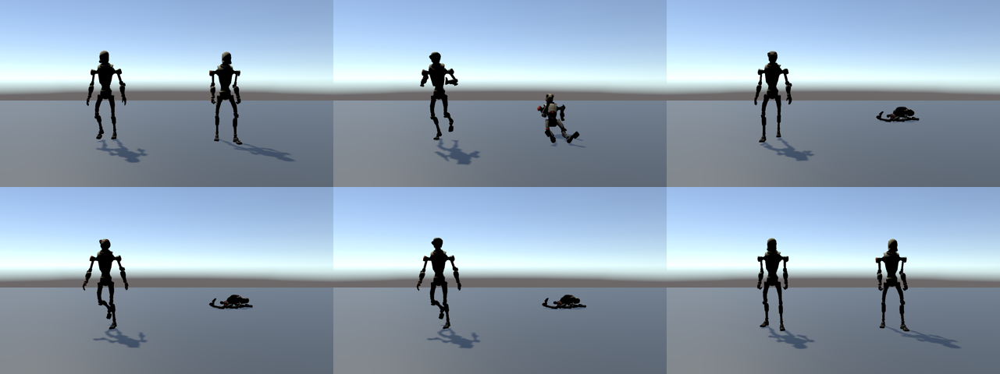

# Reactions demo

Two Robot Kyles in one scene, running headless-verified in Unity 7000.0.0a12.

**Left, inertialized transitions.** Idle, walk, run and sprint switch every four seconds with a 0.4 s inertialized request and no transition clips. The previous clip is not kept alive.

**Right, automatic ragdoll.** One `RagdollAuthoring` component. A light shove, a shove from the front, a head hit and a knockdown arrive on a timer (keys 1 to 4 do the same). Small hits stagger and recover; the knockdown goes limp, lies on the floor for four seconds, then resets and stands.

## Verified

`python3 eng/demo_check.py` plays the scene headless and reads its telemetry:

| Check | Result |
|---|---|
| Stands before the first hit (pelvis 0.9 to 1.08 m) | pass |
| Light shove deflects the head | pass, 0.12 m |
| Strength dips after the shove | pass |
| No explosion (pelvis and head within 3 m) | pass |
| Knockdown goes limp | pass |
| Knockdown puts the pelvis on the floor (below 0.35 m) | pass |
| Recovers to standing after the reset | pass |

Frames in the image above come from `capture game_view` of the same run.

## Experimental: the capture-point controller inside Unity

`RagdollAuthoring.BalanceController` hands the standing job to the MIT capture-point controller (`SA.Balance`, 93 of 100 in the pure .NET harness). It is **off by default and does not work yet in Unity Physics**: it takes over after one second of ground contact and the character then collapses. Known causes still to fix: the controller was tuned on the harness body (70 kg, 1.0 m pelvis, its own inertias), its frame and leg-length constants differ from Kyle, and it needs 480 Hz torque drives (`ReactionsDemo.HighRatePhysics`) while the demo normally runs at 60 Hz. The harness leaderboard is in `docs/leaderboard.md`.

## Not what it is

- It is **physical animation**, not a GTA-style balance controller. Standing comes from tracking toward the animation. Nothing steps, braces or catches a fall.
- The controller port (`SA.ReactionControl`, packets R1 to R8) is merged and tested but **not connected** to this demo.
- Cone-and-twist joint limits are unstable under a hard knockdown, so the demo uses ball joints. Limp limbs can bend further than a person's would.
- There is no get-up animation, so recovery is a reset.
- Single character measured; no crowd or frame-time figures exist for this path.
