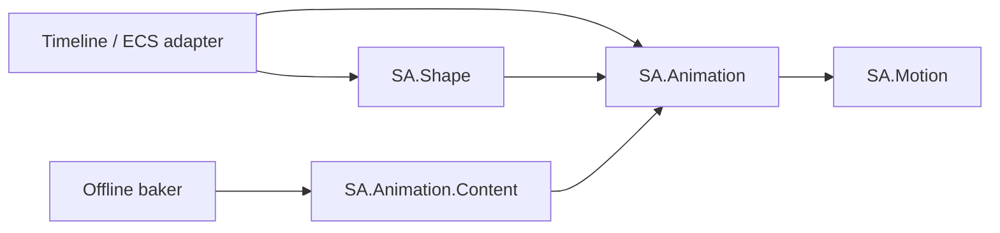

# SA.Shape: optional runtime proportions

SA.Shape is a separate engine-independent addon. Keep it optional. It supplies the geometry, smoothing, contact and skinning mathematics needed to change an existing character's proportions while it uses the same shared family clips. It does not own animation selection or advance clip time. The ECS timeline keeps those jobs.



There is no dependency from SA.Animation to SA.Shape, no Unity dependency in either library, and no Content dependency in SA.Shape. A character that does not change shape can keep the original CF1 APIs and buffers. SA.Animation 0.1.1 adds only a geometry overlay for retargeting and staged timeline evaluation; SA.Shape 0.1.0 requires that version or later. No clip, family, or `.saret` wire format changes.

The portable code is implemented. Renderer, Inspector, ECS scheduling, wardrobe, blend-shape upload, physics and real-mesh visual validation are integration work. The two target builds run under a .NET 10 test host; this is not a Burst, Unity Player, GPU, or crowd-performance receipt. See [CF2's handoff](handoff/CF2.md) for measured results.

## The representation

Keep three kinds of data distinct:

| Shared immutable data, normally per rig type | Per character | Per mesh |
|---|---|---|
| Canonical family, clips, original retarget rows/calibration, authored shape definition | Requested and smoothed parameters, shape revision, current offsets and skin deformations, neutral animation history, contact state | Original inverse binds, palette-to-rig indices, mesh/model transform, optional corrective morphs |

Changing shape does not modify rows, calibration, family reference, clip samples, inverse binds, or any other character. Rebuild from the immutable calibration every time. Never multiply a new length into last frame's length. A new skeleton topology, mesh binding, calibration or approved bone orientation needs a new target identity/definition and a RigEpoch reset. Runtime proportions do not replace offline rig mapping.

All transforms use the shared-family convention: metres, +Y up, column vectors, Hamilton xyzw quaternions, parent-before-child order, synthetic identity Root at index zero. Local joint transforms remain rigid with unit scale. Positive skin scale is carried separately, never inherited by children. Joint offsets are in the parent's calibrated coordinates; skin basis and pivot are in the influenced bone's coordinates. They are different spaces.

For each channel, `amount = clamp(value, minimum, maximum) - default`. For each joint i:

```text
length_i = exp(sum(effect.LogLength * amount))
offset_i = baseCalibration_i.Position * length_i + sum(effect.Delta * amount)
skinScale_i = exp(sum(effect.LogScale * amount))
L_i = R(basis_i) * diagonal(skinScale_i) * transpose(R(basis_i))
D_i = affine(L_i, pivot_i - L_i * pivot_i)
```

`OffsetEffect.Bone` is the child whose offset changes. `SkinEffect.Bone` is the bone whose weighted vertices deform. To lengthen a forearm, change the wrist offset and author a matching axial skin effect on the forearm, with the correct basis and elbow pivot. Changing the wrist alone moves its joint; it cannot infer how an arbitrary mesh's forearm vertices should stretch. Branches, shared shoulder weights, hands, faces and clothing often need authored corrective morphs. Positive scales prevent a reflected/collapsed skin deformation; they do not prove an artist's complete mesh will look good.

Logarithms make positive scale effects compose without effect-order dependence. Store `log(1.25)` for a channel that multiplies a segment by 1.25 at amount 1. Additive offsets handle pelvis width, shoulder spacing and other translations. Root effects are rejected. Authored nonzero defaults produce exactly the original rig at those defaults. Exact zero effect sums take an identity path so neutral settings restore the base offsets and palette without accumulating rounding drift.

`ShapeParameters.Step` is a bounded critically damped filter. Each channel has a half-life in seconds and a stored velocity. Reversing the requested shape retains that velocity; hitting a bound clears outward velocity. Half-life zero means immediate assignment. Zero dt copies state. Tiny settled errors snap to the exact requested endpoint, including neutral. It does not advance during a held or reused animation tick.

## Concrete API and storage

| Type/function | Contract |
|---|---|
| `ShapeChannel` | Stable uint Id, min/max/default, nonnegative half-life; at most 128, no duplicate Ids |
| `ShapeParameter` | Value and velocity; caller owns current and next arrays |
| `OffsetEffect` | Channel and target-bone indices, additive parent-space Delta, log length multiplier |
| `SkinEffect` | Channel and target-bone indices, three log scale multipliers |
| `SkinFrame` | Unit quaternion basis and finite pivot; omit frames for identity bases/pivots, otherwise provide exactly boneCount |
| `ShapeProfile` | Exact definition and target IDs, grounding policy, two support markers, allowed length/skin-scale ranges containing 1 |
| `ShapeDefinition` | Borrowed readonly spans over profile, channels, offset effects, skin effects and frames; not an owning/serialized object |
| `ShapeWorkspace` | Caller-owned offsets, length ratios, motion scales, skin scales, affine deformations and rigid reference models |
| `ShapeRig.Evaluate` | Rebuild the candidate geometry; maximum 16,384 offset effects and 16,384 skin effects; bone cap is SampleLocator.MaxBones |
| `ShapeGeometry` | Small identity/revision/hip-height metadata; it does not own the workspace arrays |
| `RetargetTable.ApplyGeometry` | Retarget using current offsets, hip reference and height ratio; rows and corrections stay shared |
| `ApplyReferenceGeometry` | General model-space rotation solver for parity checks against fast local rows |
| `ShapeMotionSpace.Normalize / Compose` | Convert to/from shape-neutral animation residuals for smoothing and physics recovery |
| `ShapeMotionSpace.Differentiate` | Differentiate two neutral animation poses over a positive simulation interval |
| `ShapeTimelinePose.Evaluate` | Convenience normalize, stage, compose and commit; pre-IK history |
| `ShapeTimelinePose.Prepare / Commit` | Explicit transaction for a host that also stages contacts/palettes before committing |
| `ShapeContacts.Measure / Reach` | Current rigid limb lengths and rotation-only two-bone IK; optional end orientation; reach residual is explicit |
| `TryMarker / TryAnkleTarget` | Marker evaluation and support-anchor-to-ankle conversion using the actual skin deformation |
| `ShapeSkinPalette.Build / Blend` | Position/normal palettes; optional inverse transpose of the blended vertex matrix |
| `ShapeMorphs.Evaluate` | Rebuild bounded corrective morph weights from authored base weights; no mesh rebuild or upload |

Outputs of geometry, math, IK, morph and palette kernels are scratch. An error may leave a partial scratch result. Do not expose it to a renderer or copy it into committed components. Their inputs are borrowed for the call only. The timeline convenience wrapper commits history, input snapshots and displayed pose together; its sole transient mutation on NeedsData is Motion.Waiting, as in CF1.

Every buffer with a distinct role must have disjoint storage, including byte ranges when native memory is reinterpreted. Typed overlap checks catch ordinary array/span mistakes; cross-type unsafe aliasing is not supported. ShapeParameters.Step allows exact in-place current/output, but not shifted overlap. Everything else uses separate input/output spans. No owning managed object, span, callback, or interface belongs in a serialized ECS component. Store offsets/counts into immutable native data and borrow spans when calling kernels.

With B bones, ShapeWorkspace has B entries each of Float3 offset, float length, float motion scale, Float3 skin scale, Affine deformation and RigidPose model: 108B bytes. ShapePoseWorkspace uses five B-entry Pose arrays (destination-neutral, committed-neutral, neutral scratch, displayed, display scratch), plus B RigidPose models: 228B bytes. Timeline bone state/scratch, snapshots, parameters, raw sampled target and optional IK/render scratch are additional. Phase-specific scratch can be shared across characters by a single-threaded worker; committed character state cannot. Native alignment/padding and adapter metadata are extra. Do not promise a crowd memory figure from these field sums alone.

## Reference height and grounding

`ShapeRig.Evaluate` first computes the unmodified calibrated models and the lower of the two base support markers. The support markers must be descendants of the designated hips. Their offsets represent approved sole/contact points in bone-local skin coordinates.

```text
baseHeight = baseHipModel.y - min(baseSupportA.y, baseSupportB.y)
candidateGround = min(shapedSupportA.y, shapedSupportB.y)
KeepBase: shift = baseGround - candidateGround
hipsLocalOffset += inverse(parentModelRotation) * (0, shift, 0)
recompute reference FK after that shift
height = shapedHipModel.y - finalGround
currentHeightRatio = originalBinding.HeightRatio * height / baseHeight
```

Markers include `D_i`, so a thicker sole changes the reference height too. `ShapeGrounding.Free` keeps the authored offsets without the ground-restoring shift. Without a hips role, only Free is accepted and hip metrics are zero. A hip height that is nonfinite or at/below 10 micrometres rejects. Neutral geometry preserves the original ratio exactly.

The lower reference sole is a height reference, not two-foot terrain IK. If only the left leg grows, the right foot can float before IK. Do not move both legs independently to manufacture a false rest pose. Runtime contacts need a pelvis/reach policy and explicit priorities. Quadrupeds and unusual creatures require their own approved reference supports; do not label every pair of bones humanoid feet.

Apply the new ratio to interval root translation through the existing RootMotion.Delta once. Never multiply the character's accumulated world position by a changing ratio: that teleports the actor. Gameplay root authority and current moving-support snapshots stay in the host. Root speed, gait rate and reach cannot all be preserved at arbitrary proportions; expose the chosen policy and measure sliding.

## Shape-neutral transition history

Inertialization must not store a changing bone length as an animation displacement. Otherwise an arm growing on one frame becomes a false outgoing velocity on the next cut, and ordinary pose smoothing can temporarily undo the requested length.

For ordinary non-hip bones, store:

```text
neutralPosition_i = (targetLocalPosition_i - currentOffset_i) / motionScale_i
neutralRotation_i = targetLocalRotation_i
neutralScale_i = 1
```

`motionScale_i` is the positive authored length multiplier, with root scale 1. The hips are special: their residual is in **model space**, even when an animated/shaped helper precedes them:

```text
neutralPosition_hips = (targetHipModelPosition - currentHipReference) / currentHeightRatio
motionScale_hips = currentHeightRatio
```

Run TimelinePose/PoseDecay over these neutral poses. During composition, traverse the actual parents using the corrected local rotations. For non-hips restore `offset + scale * neutralPosition`. For hips, restore the desired model position `hipReference + ratio * neutralPosition`, then convert that position through the corrected parent's inverse rotation/translation to obtain the local hip position. Do not use an independent local-space hip formula: it fails when an ancestor both rotates and changes shape.

This leaves every ordinary retargeted joint at its current offset throughout a transition, while hip animation and rotations remain continuous in neutral space. Shape changes follow the parameter filter. A proportion revision does not start a clip transition or change Continuity. An abrupt shape assignment is deliberately an abrupt body change; a pose filter cannot hide it while also preserving the requested lengths. Continuity means continuity of animation relative to the changing body, not unchanged world geometry during a body edit.

Incoming velocities at a cut are also neutral. Evaluate the incoming animation at simulation boundary times -h/+h using the **same frozen candidate shape** for both, including the timeline's sample rates and changing animation blend weights. Normalize both; call Differentiate with 2h. Use a one-sided estimate at a clamped endpoint. Exclude the shape filter's derivative. Outgoing history already stores neutral poses. Quaternion angular velocity is in the existing target-local/parent frame used by PoseDecay; SO(3) offset/Jacobian handling stays in SA.Motion.

Unique/exact-rig clips keep all their translation tracks. Normalize those samples against the **base geometry**, including its base hip reference/ratio, then compose using the current geometry. For non-hip bones this is `currentOffset + currentLength * (samplePosition - baseOffset)`. Do not send such clips through ordinary humanoid table retargeting, which intentionally keeps non-hip translations at their offsets. The explicit base-normalize/current-compose path preserves tails, jaws and other authored translations; topology and bind identity must still match.

For ragdoll recovery, first convert the actual displayed physics pose into the current rigid local/model spaces, normalize it using the current geometry, then seed neutral history. Never seed the neutral arrays with physical world positions. The physics adapter must supply that conversion and current anchors; no physics callbacks are hidden in SA.Shape.

## Frame transaction and timeline rules

Use `ShapeTimelinePose.Evaluate` when downstream contacts/rendering have a validated fallback. Use Prepare/Commit when an adapter needs the complete frame to succeed before advancing state:

1. Step parameters into next-parameter scratch. Copy their values into candidate shape values.
2. Rebuild candidate geometry from immutable base rows. Keep the prior committed geometry alive.
3. Pin and sample the shared clip segments; blend canonical poses; retarget using candidate geometry. Prepare frozen-geometry incoming derivatives when needed.
4. Call ShapeTimelinePose.Prepare. It normalizes, calls TimelinePose.Prepare, composes corrected geometry, and returns a candidate ShapeFrameState. It does not change committed state, bones, pose or input snapshots. If Action is Reused, skip the remaining commit/publication steps and use the already committed result; successful reuse does not prepare fresh scratch.
5. On success, run optional IK from DisplayScratch into a distinct IK scratch array. Validate/build palettes into render scratch. Do not put IK corrections back into neutral animation history.
6. Call ShapeTimelinePose.Commit using the successful candidate and original unmodified snapshots/scratch. Then publish the prepared contact/render results and swap/commit the parameters and geometry. All fallible work must precede publication. External jobs and GPU consumers need normal dependency/fence ownership.
7. On any failure, discard the candidate. On NeedsData only, record the returned candidate.Motion.Waiting into committed Motion so retry creates a fresh boundary; keep pose, geometry, parameters and root fixed. Evaluate does this transient update itself.

Do not mutate the same character, its inputs or its staging buffers between Prepare and Commit. They are not a multiwriter transaction system and do not detect a stale concurrent writer. Commit validates every staged pose/history/header before copying any committed output. A caller may discard a successful prepare; a test proves it.

`ShapePoseWorkspace.DisplayScratch` and Displayed are pre-IK poses by default. Keep post-IK output separate so recovery/animation history has an explicit origin. If a host replaces DisplayScratch with a validated post-IK result before Commit, neutral history still stays pre-IK; document that choice in the adapter and never feed that output back as ordinary motion history.

| Case | Required behavior |
|---|---|
| Successful same Tick, same inputs, same revision/geometry | Reused; do not step shape/root/contact history twice |
| Same Tick with changed shape | TickConflict; no commit |
| Same Tick with changed offsets but a reused revision | Supplemental geometry stamp rejects; it is an accidental-mutation check, not a content/security hash |
| Pause or zero dt with a changed shape | TickConflict; use an explicit Seek for a customization preview |
| Later Advance tick, same definition/rig | Shape may change; neutral transition proceeds without restarting |
| New definition or target identity | New RigEpoch or explicit Seek/Teleport; otherwise InvalidTable |
| Seek/Teleport | Reset neutral history, compose the requested current shape; no gameplay root accumulation |
| NeedsData | Preserve committed tick, shape and pose; release no pinned input prematurely; retry the same boundary |
| Reverse clip playback | SampleSeconds may decrease; shape filters and inertial decay use positive simulation dt |

Increase Revision whenever effective parameters, deformation or morph settings change. Definition identity covers the immutable authored data. The supplemental stamp covers pose-affecting offsets/scales/hip data, not skin matrices, morph weights or mesh contents; never reuse a revision to disguise changes to those. Shape metadata does not take ownership of any referenced arrays. Rollback restores geometry, parameters, the complete ShapeFrameState, both neutral history/snapshots and contact state together.

## Contacts without bone stretching

`ShapeContacts.Measure` measures upper-to-middle and middle-to-end distances from the current rigid FK. It checks ordered ancestry, finite nonzero lengths and hierarchy. Static intermediate/twist bones are allowed; no Unity axis assumptions are made.

Reach uses the existing TwoBoneIK law-of-cosines solver, saves the original upper and middle **model** rotations, applies the upper total delta, recomputes FK, then applies the lower total delta to the original middle model rotation relative to its now-correct parent. Recomputing FK between those assignments matters. Optional end orientation is converted from model space through its actual parent. All local translations remain bit-for-bit unchanged. A clamped target returns Clamped plus the actual Residual; the host chooses pelvis adjustment, release or lower contact weight instead of stretching a limb.

For an anchored sole:

```text
desiredAnkleModel = supportAnchorModel - desiredFootModelRotation * (D_foot * soleBoneOffset)
```

TryAnkleTarget implements that formula, including skin basis, pivot and sole thickness. Support anchors and poles passed to these functions are in the same model coordinates as FK. The host converts world/platform-local anchors using the actor's current rigid root; it must not rescale a stored world anchor when the character grows. Release/reset on teleport and invalid support generation. An authored bone marker approximates a real blended mesh contact patch; validate it on the actual foot geometry. Bilateral pelvis solve, moving-platform contact state, collision casts, slope priorities and motor authority remain in the existing contacts/Legs adapter.

## Skin and normals

The existing mesh binding stays authoritative:

```text
palette_i = MeshFromModel * rigidModel_i * D_i * originalInverseBind_i
```

Do not rebuild inverse binds from a deformed rest pose; that cancels the requested deformation. Root/world uniform instance scale belongs in the adapter's model/mesh conversion once. Preserve the original per-renderer palette order; rig order and palette order are not interchangeable.

Build also returns the inverse transpose of each position matrix's linear part. Use it for a single influence, or an explicitly documented approximation in a shader. For mathematically correct linear-blend-skinning normals, first form the normalized weighted **position matrix**, then inverse-transpose its linear part. `ShapeSkinPalette.Blend` provides that reference path. Blending per-bone normal matrices is generally a different result. Renormalize final normals, transform/orthogonalize tangents against them, and preserve tangent handedness; the mesh/shader adapter owns that work. Even valid rigid bones can produce a singular blended LBS matrix (opposed rotations); Blend returns UnsupportedScale so the renderer has an explicit fallback. A dual-quaternion renderer needs an additional stretch representation; do not reinterpret these affine palettes as dual quaternions.

## Authoring and a durable definition

The runtime structs are not a disk format. The remaining importer can be small because its source contract is fixed here. Use a versioned `.sashape` UTF-8 JSON source asset with these required fields:

```json
{
  "schemaVersion": 1,
  "targetRigId": "64 lowercase hexadecimal digest characters",
  "definitionId": "64 lowercase hexadecimal digest characters",
  "units": "metres",
  "up": "+Y",
  "grounding": "KeepBase",
  "supports": [{ "bone": 6, "offset": [0, -0.1, 0.05] }, { "bone": 9, "offset": [0, -0.1, 0.05] }],
  "lengthRange": [0.25, 4],
  "skinScaleRange": [0.125, 8],
  "channels": [{ "id": 1, "name": "legLength", "min": -1, "max": 1, "default": 0, "halfLifeSeconds": 0.1 }],
  "offsetEffects": [{ "channel": 0, "bone": 5, "delta": [0, 0, 0], "logLength": 0.22314355 }],
  "skinEffects": [{ "channel": 0, "bone": 4, "logScale": [0, 0.22314355, 0] }],
  "skinFrames": [],
  "morphs": [],
  "morphEffects": []
}
```

This is a field example, not a valid identity-bearing asset or a complete leg definition. A full skinFrames array has objects `{ "basis": [x,y,z,w], "pivot": [x,y,z] }` in target-bone order. Morph objects contain min/max/base and a renderer-specific stable name; MorphEffect contains channel/morph indices and delta. Runtime shape and morph indices are distinct. Resolve bone/morph names to indices offline against the exact target/mesh IDs; retain names/source provenance as optional diagnostics. Changing a channel's order changes its index references. Display labels never replace stable channel IDs.

For reproducible definition IDs, implement a cold canonical writer rather than hashing arbitrary JSON formatting. Its v1 byte recipe is: ASCII `SA.SHAPE`, little-endian u32 schema 1; target AssetId as its four u64 words; byte grounding; two `(i32 bone, 3*f32 offset)` supports; four f32 range bounds in constructor order; u32 channel count then `(u32 id, f32 min,max,default,halfLife)`; u32 offset count then `(i32 channel,bone, f32 delta.x,y,z,logLength)`; u32 skin count then `(i32 channel,bone, f32 logScale.x,y,z)`; u32 frame count then `(f32 basis.x,y,z,w,pivot.x,y,z)`; u32 morph count then `(f32 min,max,base, u32 nameByteCount, NFC UTF-8 name bytes)`; u32 morph-effect count then `(i32 channel,morph, f32 delta)`. Normalize negative zero to positive zero and normalize/canonicalize quaternion signs using the existing convention before writing floats. Hash these bytes with SHA-256; read digest words like ContentIdentity.Hash. Exclude definitionId, human labels and optional provenance. Include a new schema if the semantics change. Keep mesh-target identities/provenance with mesh-specific morph bindings. The importer/canonical writer is **specified, not implemented** in this packet; do not serialize ref structs or raw C# memory to invent a file format.

Before publishing a definition, validate the full channel domain offline. For a sum `sum(k_j * amount_j)`, derive an interval by adding the minimum/maximum of each k_j times that channel's two endpoint amounts, collecting repeated effects of the same channel first. Check exponentiated length and skin intervals against the profile ranges. Check additive-offset intervals for possible zero/reversed segment lengths and require artist approval or tighter bounds. Ground/marker reach and mesh quality need pose/shape sweeps, not just scalar intervals. Runtime rejects overflowing/out-of-range geometry; it never silently chooses a different proportion. Evaluate neutral, extrema, asymmetry and mixed interior values on the real mesh, skins and clothes before promising continuous customization.

UMA's authored DNA/converter model is useful precedent; this addon does not use or translate UMA code. The inspected reference was [UMA develop at 67153819d034f8f48c5cb0378cb81906880e507b](https://github.com/umasteeringgroup/UMA/tree/67153819d034f8f48c5cb0378cb81906880e507b). Mesh/wardrobe generation, material atlases, asset streaming and editor DNA tools remain separate features, not an animation-core dependency.

## Bounded integration tasks for the next AI

| Packet | Owns | Done when |
|---|---|---|
| SH1: source/import binding | `.sashape` parser/canonical writer, target/mesh validation, immutable native shape blob, approved rig-specific profiles | Corrupt IDs/ranges/bone names diagnose visibly; identical rig types share a blob; neutral and interval gates pass; golden source/hash fixture |
| SH2: optional Unity adapter | Separate `com.sa.unity.shape`/assembly depending on the core Unity adapter; parameters/revision/native buffers; timeline transaction hookup | Add/remove addon leaves ordinary characters working; visible controls show named shape changes; missing definition is a HelpBox; single writer and job lifetimes proven |
| SH3: skin/contact renderer | Affine skin palette upload, normals/tangents, corrective morph upload and current shape contact markers/lengths | Real mesh rest restoration, long/short limbs, thick soles, asymmetric reach, moving supports and interrupted clips captured; no inverse-bind rewrite or stretched joints |
| SH4: physical/production gate | Explicit ragdoll/collider/cloth policy and fixed-tick shape application, corpus sweeps, performance | Collider centres/radii, joint anchors, inertia/mass and motors are updated coherently or shape edits are visibly refused while physical; 50/500 pilot and platform/Burst receipts recorded |

Do not change a live ragdoll's visual proportions alone and call physical integration complete. Choose a visible supported mode: customization while kinematic followed by one physics rebuild, or synchronized runtime physical updates. Collider resize/contact migration/mass distribution is a separate system, with old/new geometry snapshots; it is not achieved by multiplying bone transforms.

For the later physical adapter, the nonuniform inertia calculation is fixed here. For an authored per-body affine deformation `x' = A*x + t`, with original mass m > 0, COM c and inertia I about that COM, recover the centred second moment per unit mass `C = (0.5*trace(I)*Identity - I)/m`. Then `c' = A*c+t`, `C' = A*C*transpose(A)`, and `I' = m'*(trace(C')*Identity-C')`. Choose fixed mass (`m'=m`) or fixed density (`m'=m*det(A)`) explicitly. Diagonalize I' for an engine's principal-inertia frame; scaling the old diagonal componentwise is wrong when axes mix. This is exact for the affinely transformed body distribution, not for a capsule merely refitted to that distribution. If primitive refitting changes the shape, calculate mass/inertia from the resulting primitives instead. Joint anchors must be rebuilt from the same shaped rigid joints, not from visual skin matrices. Publish the coherent collider/COM/inertia/anchor set at one fixed-step boundary. This formula is specified for SH4, not implemented or physically verified by CF2.

Use the repository's official Unity CLI workflow when implementing those Unity packets. Read AGENTS first; do the person's visible Editor walk; leave no harness in their scene. CF2 changes no Unity project, scene, prefab, manifest, installed DLL or reference-package source.

Portable verification:

```bash
eng/dotnet_test.sh tests/SA.Shape.Tests/SA.Shape.Tests.csproj
eng/dotnet_test.sh tests/SA.Animation.Tests/SA.Animation.Tests.csproj
eng/dotnet_test.sh tests/SA.Motion.Tests/SA.Motion.Tests.csproj
python3 eng/check_shape_package.py
python3 eng/check_source_rules.py
git diff --check
```

Pack SA.Shape, SA.Animation and SA.Motion from the same checkout when distributing the addon. The .nupkg is optional; using source projects remains valid. `SA.Animation.Content` is needed by the offline baker, not by runtime shape evaluation. Check the CF2 handoff before choosing an integration branch; other C-series packets may already have advanced beyond the original CF1 plan.
